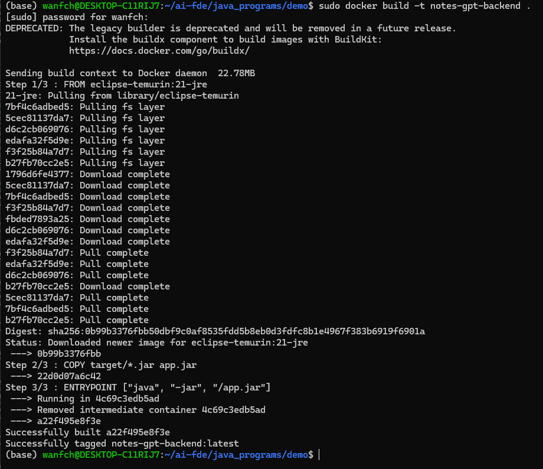
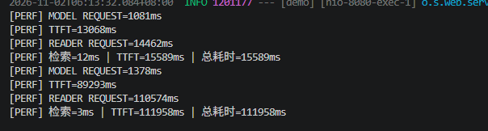

# Getting Started

### Reference Documentation
For further reference, please consider the following sections:

* [Official Apache Maven documentation](https://maven.apache.org/guides/index.html)
* [Spring Boot Maven Plugin Reference Guide](https://docs.spring.io/spring-boot/4.1.2/maven-plugin)
* [Create an OCI image](https://docs.spring.io/spring-boot/4.1.2/maven-plugin/build-image.html)
* [Spring Web](https://docs.spring.io/spring-boot/4.1.2/reference/web/servlet.html)

### Guides
The following guides illustrate how to use some features concretely:

* [Building a RESTful Web Service](https://spring.io/guides/gs/rest-service/)
* [Serving Web Content with Spring MVC](https://spring.io/guides/gs/serving-web-content/)
* [Building REST services with Spring](https://spring.io/guides/tutorials/rest/)

### Maven Parent overrides

Due to Maven's design, elements are inherited from the parent POM to the project POM.
While most of the inheritance is fine, it also inherits unwanted elements like `<license>` and `<developers>` from the parent.
To prevent this, the project POM contains empty overrides for these elements.
If you manually switch to a different parent and actually want the inheritance, you need to remove those overrides.

4. 总耗时 ≈ 网络(1.1s) + 服务端首字延迟(~12s) + 流式生成(~11-14s)
   → 三段里两段在模型侧，Java 转发是纯管道，无可优化
5. kimi 响应头 1 秒就返回，但首字要等 12 秒——说明延迟在模型生成侧
   （以后若做产品优化，方向是换更快的模型/流式更早吐字，而不是应用代码）
