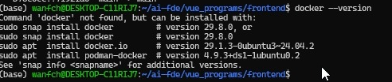
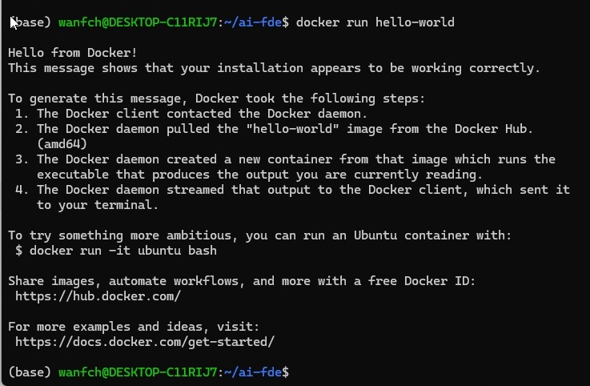
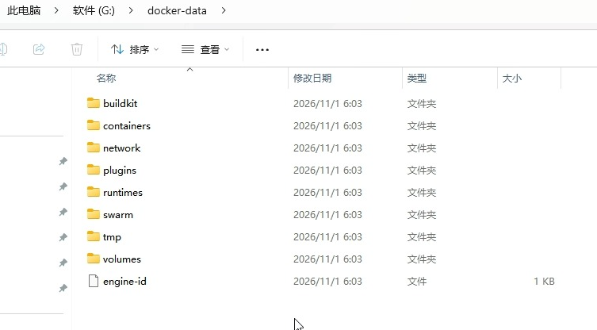
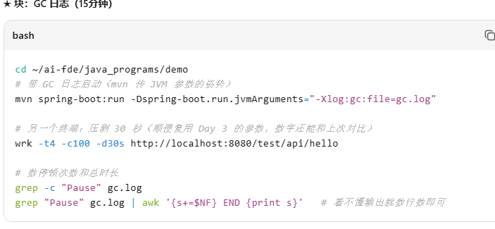

# notes-gpt-backend

AI 笔记问答后端：Spring Boot 3 + Java 21 + kimi API

## 启动
1. JDK 21+，Maven 3.9+
2. export MOONSHOT_API_KEY=sk-你的key
3. mvn spring-boot:run

## 接口
POST /api/chat　body: {"question":"..."}　→ 纯文本回答

## 路线图
- [x] W3 同步问答接口
- [ ] W4 SSE 流式 + RAG 检索接入
- [ ] W5 Docker + CI

