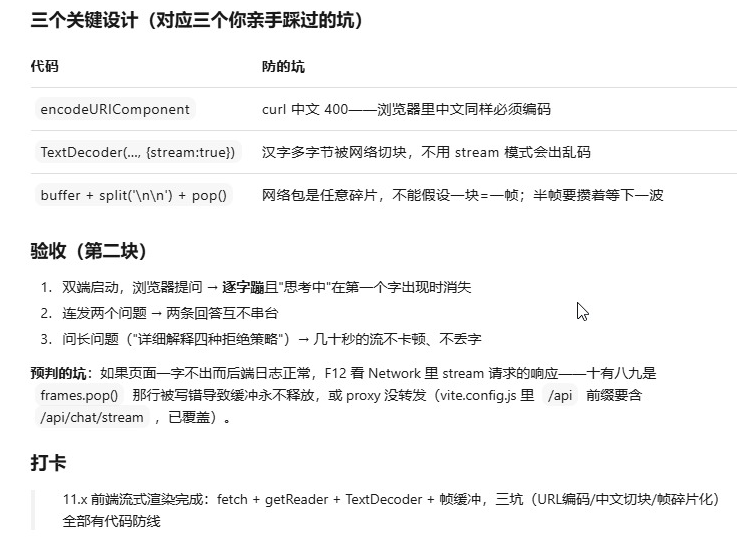
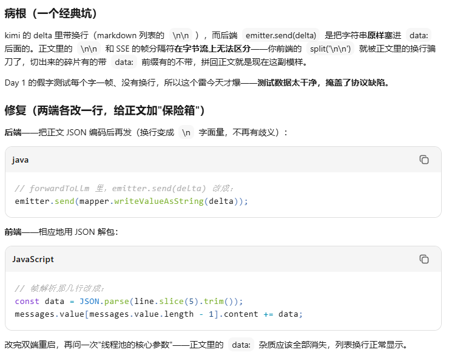
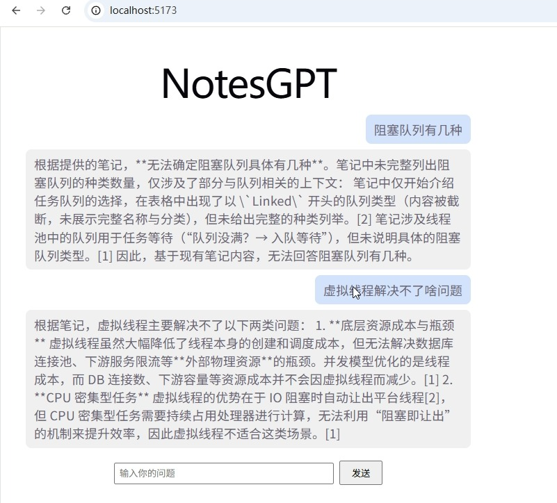
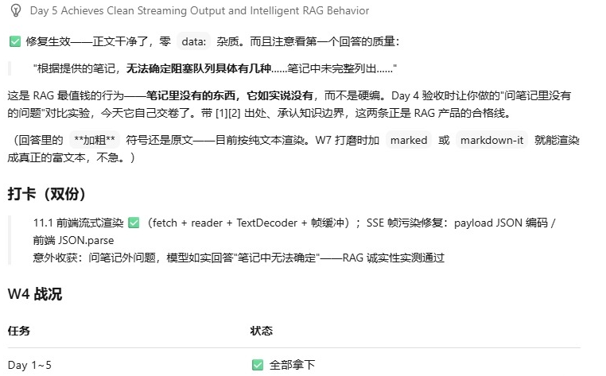
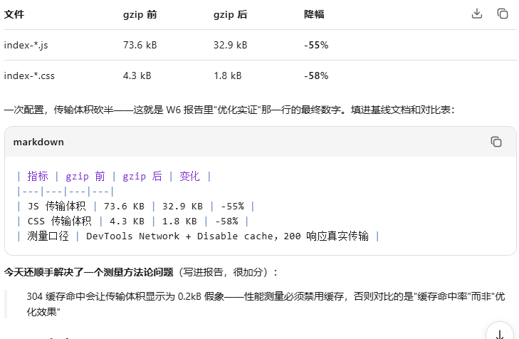

# NotesGPT Frontend

 Vue3 + Pinia + SSE 流式渲染的 AI 笔记问答界面

## 功能
- fetch + ReadableStream 手写 SSE 客户端（帧缓冲 + TextDecoder 中文切块处理）
- 打字机流式渲染，首字到达即切换状态
- 引用 chips 点击展开原文
- localStorage 会话持久化（刷新不丢）

## 启动
npm install && npm run dev → localhost:5173（需后端 8080）

## 部署
nginx 容器，/api 反代后端（proxy_buffering off 保 SSE），gzip -55% 传输

## 启动
1. Node 18+
2. npm install
3. npm run dev  → http://localhost:5173

（依赖 /api/chat 接口，见 notes-gpt-backend 仓库）

